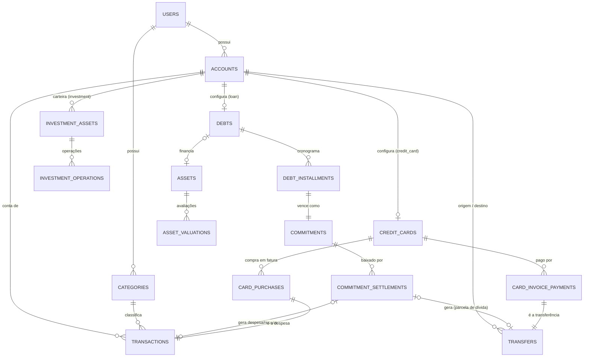

# Modelo de dados

PostgreSQL 16, acessado só pelo backend via SQLAlchemy 2.0. Cada tabela pertence a uma slice, que é a única a consultá-la ([arquitetura](visao-geral.md#dependências-entre-slices)). Os modelos ORM em `backend/src/features/<slice>/models.py` são a fonte de verdade; esta página é o mapa.

## Convenções

| Convenção | Regra |
|---|---|
| Chave primária | `id` UUID gerado na aplicação (`uuid4`) |
| Dono | Toda tabela de domínio tem `user_id` → `users.id` com `ON DELETE CASCADE` e índice; toda consulta filtra por ele ([ADR-002](../decisoes/ADR-002-multi-user-from-start.md)) |
| Dinheiro | `Numeric(12, 2)`, `Decimal` no Python; `amount` sempre positivo, a direção vem do tipo |
| Datas | `Date` para fatos financeiros (`occurred_at`, `due_date`); `DateTime` com fuso para auditoria (`created_at`) |
| Histórico | Contas e categorias são **arquivadas** (`is_archived`), nunca apagadas, quando há lançamentos; FKs para elas usam `ON DELETE RESTRICT` |
| Vínculo opcional | Perder o vínculo não apaga o fato: `goal_id` e `recurring_transaction_id` usam `ON DELETE SET NULL` |
| Valores fixos | Conjuntos novos são texto com `CHECK`; os enums nativos antigos continuam ([ADR-019](../decisoes/ADR-019-texto-com-check-em-vez-de-enum.md)) |
| Nomes | Tabelas no plural em `snake_case`; constraints nomeadas à mão (`uq_<tabela>_<colunas>`, `ix_...`, `ck_...`) |

## Tabelas por slice

`id`, `user_id` e `created_at` foram omitidos.

| Slice | Tabela | Colunas principais |
|---|---|---|
| `auth` | `users` | `email` (único), `password_hash`, `password_changed_at` |
| | `password_reset_tokens` | `token_hash`, `expires_at`, `used_at` |
| `accounts` | `accounts` | `name`, `type`, `opening_balance`, `is_archived` |
| `categories` | `categories` | `name`, `dre_group`, `ir_kind`, `is_archived` |
| `transactions` | `transactions` | `account_id`, `category_id`, `goal_id?`, `recurring_transaction_id?`, `type`, `source`, `amount`, `description`, `occurred_at` |
| `budgets` | `budgets` | `category_id`, `month`, `limit_amount` — único por (`user_id`, `category_id`, `month`) |
| `goals` | `goals` | `name`, `target_amount`, `target_date`, `is_achieved` |
| `recurring` | `recurring_transactions` | `account_id`, `category_id`, `type`, `amount`, `frequency`, `next_occurrence_date`, `is_active`, `generate_as_commitment` |
| `statement_import` | `statement_imports` | `account_id`, `file_name`, `file_sha256`, `rows_total`, `transactions_created`, `rows_skipped` |
| `commitments` | `commitments` | `direction`, `description`, `counterparty`, `amount`, `due_date`, `category_id`, `account_id?`, `installment_group_id`, `installment_number/count`, `recurring_transaction_id?`, `debt_id?`, `is_canceled` |
| | `commitment_settlements` | `commitment_id`, `transaction_id?`, `transfer_id?`, `amount`, `paid_at` |
| `transfers` | `transfers` | `from_account_id`, `to_account_id`, `amount`, `occurred_at`, `description` |
| `credit_cards` | `credit_cards` | `account_id`, `closing_day`, `due_day`, `credit_limit`, `default_payment_account_id` |
| | `card_purchases` | `transaction_id`, `credit_card_id`, `invoice_closing_date` |
| | `card_invoice_payments` | `credit_card_id`, `invoice_closing_date`, `transfer_id`, `amount`, `paid_at` |
| `debts` | `debts` | `account_id`, `creditor`, `principal`, `installments`, `system`, `monthly_rate`, `first_due_date`, `payment_account_id`, `interest_category_id` |
| | `debt_installments` | `debt_id`, `number`, `commitment_id`, `principal_part`, `is_superseded` |
| | `debt_amortizations` | `debt_id`, `transfer_id`, `amount`, `paid_at`, `mode` |
| `assets` | `assets` | `name`, `kind`, `acquired_at`, `acquisition_value`, `debt_id?` (único), `disposed_at` |
| | `asset_valuations` | `asset_id`, `valued_at`, `value` — único por (`asset_id`, `valued_at`) |
| `investments` | `investment_assets` | `account_id`, `name`, `symbol`, `asset_class`, `quote_source`, `is_archived` |
| | `investment_operations` | `asset_id`, `kind`, `occurred_at`, `quantity`, `unit_price`, `fees`, `amount`, `cost_basis`, `gain`, `transfer_id?`, `transaction_id?` |
| | `investment_quotes` | `asset_id`, `quoted_on`, `price`, `source` — único por (`asset_id`, `quoted_on`) |
| | `quote_request_log` | `requested_at`, `provider`, `symbol`, `ok` (controle do teto mensal) |
| `tax` | `tax_year_settings` | `year`, `dependents_count` — único por (`user_id`, `year`) |
| | `tax_income_statements` | `year`, `payer_name`, `kind`, `gross_income`, `social_security`, `withheld_tax` |
| `insurance` | `insurance_policies` | `kind`, `insurer`, `premium_amount`, `premium_frequency`, `starts_on`, `renews_on`, `asset_id?`, `recurring_id?`, `commitment_id?`, `is_active` |
| `retirement` | `retirement_plans` | `current_age`, `target_age`, `monthly_income_wanted`, `public_benefit_monthly`, `real_return_annual`, `withdrawal_rate`, `monthly_contribution`, `include_assets` |

`dashboard` e `reports` não têm tabelas: são só leitura ([ADR-013](../decisoes/ADR-013-dre-competencia-fluxo-caixa.md)).

## Relacionamentos centrais

O padrão se repete: **um registro de domínio aponta para o lançamento ou a transferência que ele gerou**, em vez de o lançamento conhecer o domínio. Assim `transactions` não depende de ninguém, e desfazer uma operação sabe exatamente o que apagar.

## Enums e valores fixos

| Coluna | Tipo no banco | Valores |
|---|---|---|
| `accounts.type` | enum `account_type` | `CHECKING`, `SAVINGS`, `CREDIT_CARD`, `LOAN`, `INVESTMENT` |
| `transactions.type` | enum | `INCOME`, `EXPENSE` |
| `transactions.source` | enum | `MANUAL`, `RECURRING`, `IMPORT` |
| `recurring_transactions.frequency` | enum | `WEEKLY`, `MONTHLY` |
| `commitments.direction` | enum | `PAYABLE`, `RECEIVABLE` |
| `categories.dre_group` | texto + `CHECK` | `revenue`, `deduction`, `variable_expense`, `fixed_expense`, `financial_expense`, `financial_revenue` |
| `categories.ir_kind` | texto + `CHECK` | `deduction_health`, `deduction_education`, `deduction_pension` |

Nos enums nativos o banco guarda o **nome** do membro em maiúsculas (`LOAN`), não o valor do Python (`loan`). Valores acrescentados a um enum não saem no `downgrade`.

## Migrações

Alembic, em `backend/alembic/versions/`, uma migração por mudança de schema. Comandos em [backend/README](../../backend/README.md#migrações).

| Revisão | Marco | O que faz |
|---|---|---|
| `f30ba74d5b54` | 2 | usuários e contas |
| `f960bb5ff835` | 3 | categorias e lançamentos |
| `b6be3270c643` | 4 | metas e orçamentos |
| `5794659919a8` | 5 | recorrências |
| `a1c9e4d27f10` | 7 | tokens de recuperação de senha, `users.password_changed_at` |
| `c3e8b1f05a92` | 7 | importações de extrato |
| `d4a7c2e91b36` | 8 | compromissos e baixas |
| `e5b8d3f02c47` | 8 | recorrência gera compromisso |
| `f6c9e4a13d58` | 9 | transferências |
| `a7d2f5b84e69` | 9 | cartões, compras e pagamentos de fatura |
| `b8e3a6c5d1f7` | 10 | `accounts.opening_balance`, `categories.dre_group` |
| `c9f4b7a2e6d1` | 11 | valor `LOAN`; dívidas, parcelas e amortizações; `commitments.debt_id`; baixa só com transferência |
| `d1a8e5c3b7f2` | 12 | bens e avaliações |
| `e2b9c6d4a8f3` | 13 | valor `INVESTMENT`; ativos, operações, cotações e registro de requisições |
| `f3c1d7a9b5e2` | 14 | `categories.ir_kind`, configurações do ano e informes de rendimentos |
| `g4d2e8b6c1a3` | 15 | apólices e plano de aposentadoria |

Os Marcos 16 e 17 não mudaram o schema.

Cuidados:

- **Revise todo `--autogenerate`.** Ele não detecta tudo e tenta recriar enums existentes; use `postgresql.ENUM(..., create_type=False)` e nomeie as FKs à mão.
- **Teste o ciclo** `upgrade → check → downgrade → upgrade → check` no banco local antes de abrir o pull request.
- `backend/tests/test_migrations.py` aplica **todas** as migrações num banco vazio e grava uma conta de cada tipo; ele pega erros que o `create_all` dos testes comuns não pega.
- Ao criar um modelo novo, importe-o no `conftest.py` para que a suíte crie a tabela.
- Em produção, as migrações rodam na subida do container ([ADR-018](../decisoes/ADR-018-migracoes-na-subida.md)). **Evite `alembic downgrade` em produção**: ele apaga tabelas e baixas; só com backup em mãos.

## Dados sensíveis

| Dado | Tratamento |
|---|---|
| Senha | Só o hash Argon2 (`password_hash`), nunca exposto em resposta |
| Token de recuperação | Só o hash (`token_hash`), uso único e expiração curta |
| Extrato importado | O arquivo não é guardado; ficam os lançamentos, o nome e o hash do arquivo |
| Documentos de terceiros | Nenhum CPF ou CNPJ armazenado (RB-043) |
