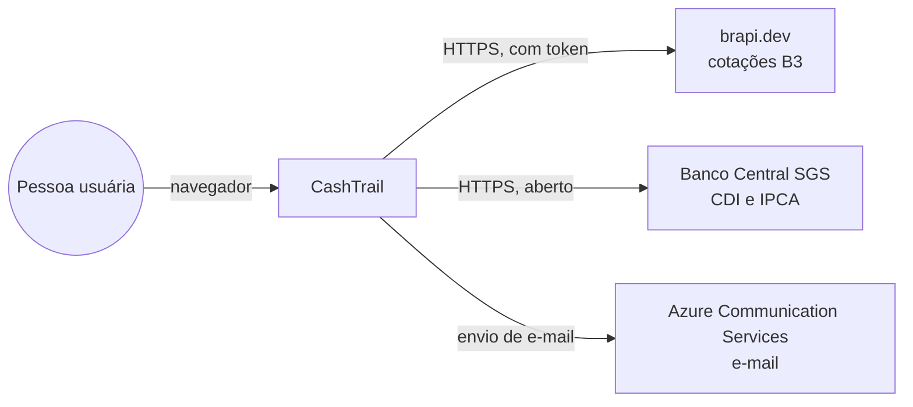
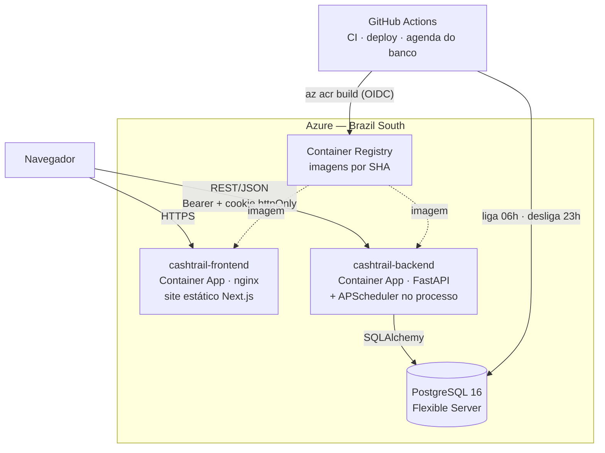
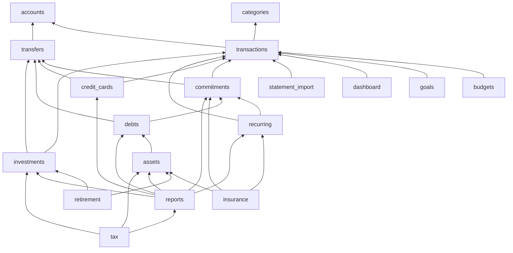
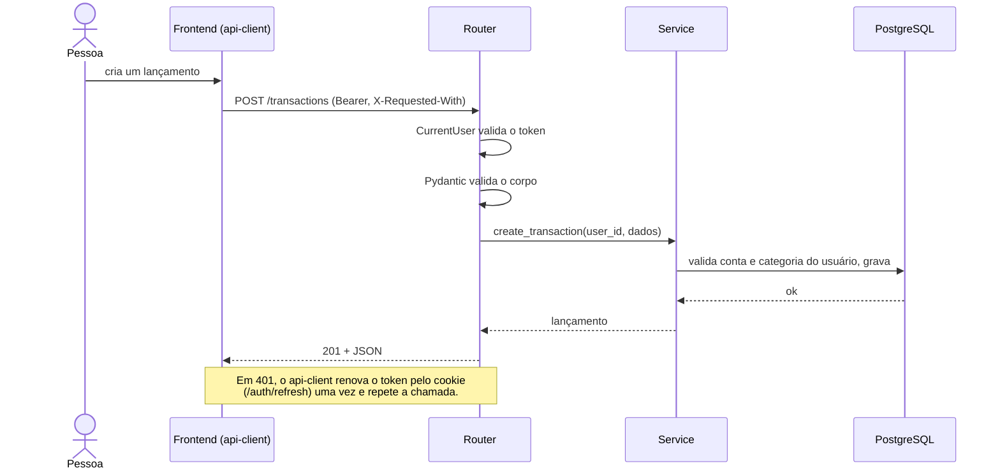

# Arquitetura

Como o CashTrail é montado hoje. As decisões por trás de cada escolha estão nos [ADRs](../decisoes/README.md); a organização interna de cada lado, nos READMEs de [backend](../../backend/README.md) e [frontend](../../frontend/README.md).

## Contexto

Nenhum serviço externo chama o CashTrail (sem webhooks). Falha de uma fonte externa nunca derruba a API: cotações ficam na última conhecida e o IPCA é só contexto. Detalhes e limites em [Integrações externas](../referencia/integracoes-externas.md).

## Containers

| Container | Responsabilidade | Não faz |
|---|---|---|
| Frontend | Apresentação, validação espelhada nos formulários, sessão em memória | Regra de negócio, cálculo de dinheiro, acesso a banco |
| Backend | Toda regra de negócio, autenticação, autorização, persistência, jobs, integrações | Servir a interface |
| PostgreSQL | Integridade (FKs, `CHECK`, `UNIQUE`) como última linha de defesa | Lógica de negócio |

Pontos que costumam surpreender:

- O navegador fala **direto** com o backend; o nginx do frontend só serve arquivos estáticos ([ADR-008](../decisoes/ADR-008-frontend-estatico-container-apps.md)).
- O agendador roda **dentro** do processo da API ([ADR-005](../decisoes/ADR-005-apscheduler-over-celery.md)). Como o Container App escala a zero, os jobs também rodam na subida.
- As migrações rodam na subida do container, o que exige **no máximo uma réplica** ([ADR-018](../decisoes/ADR-018-migracoes-na-subida.md)).
- Há um único ambiente de nuvem (produção). Não existe staging: o CI com PostgreSQL real é o portão de qualidade, e um staging dobraria o custo.

## Vertical slices

O backend é organizado por funcionalidade de negócio, não por camada técnica ([ADR-007](../decisoes/ADR-007-vertical-slices-transactions-kernel.md)). Cada slice em `backend/src/features/<nome>/` tem rota, schema, regra, repositório, modelo e testes; o frontend espelha a divisão em `frontend/src/features/<nome>/`.

| Grupo | Slices |
|---|---|
| Núcleo | `auth`, `accounts`, `categories`, `transactions` |
| Planejamento | `budgets`, `goals`, `recurring`, `commitments`, `transfers` |
| Crédito e dívidas | `credit_cards`, `debts` |
| Patrimônio | `assets`, `investments`, `insurance`, `retirement` |
| Análise (só leitura) | `dashboard`, `reports`, `tax` |
| Entrada de dados | `statement_import` |

### Dependências entre slices

Levantado dos imports do código em 2026-11-04 (seta = "depende de"; `auth` é usado por todas via `CurrentUser` e foi omitido):

Regras (verificadas no código):

1. **Sem ciclos.** `transactions` não depende de nenhuma slice de negócio além dos cadastros (`accounts`, `categories`); nenhum cadastro depende dela. Por isso `accounts` não calcula saldo: quem calcula é `reports`.
2. **Só pelo `service`.** Uma slice chama a função pública do `service.py` de outra. Do `models.py` alheio só se importam **enums e constantes** (`TransactionType`, `NON_CASH_TYPES`) e, no máximo, a classe ORM como anotação de tipo. Nenhuma slice consulta a tabela de outra nem usa o `repository.py` dela.
3. **Leitura não é dependência.** Ninguém depende de `dashboard` nem de `reports`, com uma exceção: `tax` lê o patrimônio de `reports.net_worth` para os bens em 31/12.
4. **Composição numa transação.** Quando uma operação cria registros em várias slices (pagar parcela de dívida cria uma transferência e uma despesa), os services expõem `commit=False` (`create_transaction`, `create_transfer`, `create_commitment`, `cancel_commitment`) e a slice que orquestra faz um único commit.
5. **Duplicar é melhor que acoplar.** Uma função de poucas linhas usada por duas slices é copiada (por exemplo, `split_amount`), em vez de criar dependência.

### O que é transversal

Só duas pastas são compartilhadas, cada uma com responsabilidades nomeadas:

| Pasta | Contém |
|---|---|
| `backend/src/core/` | configuração, conexão com o banco, hash e JWT, `CurrentUser` e proteção CSRF, rate limiting, adaptadores de e-mail |
| `frontend/src/lib/` | `api-client` (token, refresh, CSRF), tradução de erros, formatação de moeda e data, tema dos gráficos |

Não existem `utils/`, `helpers/` nem `shared/` genéricos.

### Cálculos isolados

Os cálculos mais densos ficam em módulos puros, testáveis sem banco: `debts/schedule.py` (Price/SAC), `credit_cards/cycle.py` (ciclo da fatura), `investments/position.py` (custo médio), `tax/calc.py` (IRPF) e os módulos de `reports` (`balances_dre`, `cash_flow`, `calendar_view`, `net_worth`, `csv_export`).

## Fluxo de uma requisição

## Observabilidade

Hoje: logs da aplicação no *Log stream* do Container App e `/health`, que devolve a versão (SHA do commit) e serve de prova de que o deploy subiu. Monitoramento e alertas de produção estão no [backlog](../roadmap.md#backlog).

## Ambientes

| Ambiente | Banco | Como sobe |
|---|---|---|
| Local | PostgreSQL do Docker Compose (`localhost:5544`) | [Ambiente local](../guias/ambiente-local.md) |
| Testes e CI | PostgreSQL 16 efêmero via Testcontainers, um por sessão de testes | `pytest` |
| Produção | Azure PostgreSQL Flexible Server, ligado das 06h às 23h | [Deploy e operação](../guias/deploy-e-operacao.md) |
