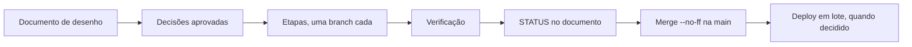

# Como trabalhamos

O CashTrail evolui em **marcos**: cada um entrega uma funcionalidade completa, do desenho ao navegador. A regra que atravessa tudo é **desenho antes de código**: nenhuma funcionalidade nova começa sem um documento de desenho aprovado, e nenhuma escolha difícil de defender é tomada em silêncio.

Para contribuições externas (fork, pull request, padrões de código e commits), veja o [CONTRIBUTING](../../CONTRIBUTING.md).

## Ciclo de um marco



1. **Documento de desenho** em [`docs/marcos/`](../marcos/README.md), com o próximo número livre. Conteúdo mínimo:
   - objetivo e critério de saída ("pronto quando...");
   - o que já existe no código (lido, não lembrado);
   - pesquisa com fontes e data, quando há fato externo;
   - escopo dentro e fora;
   - requisitos (`RF-` e `RB-`, continuando a numeração do [catálogo](../referencia/requisitos.md));
   - decisões no formato abaixo;
   - modelo de dados, plano em etapas, riscos (`R-<marco>.<n>`).
2. **Aprovação.** As decisões são respondidas antes de qualquer código. Protótipos de interface são vistos antes de construir a tela.
3. **Uma branch por etapa**, criada a partir da anterior (`marco-<n>-etapa-<k>-<slug>`). Cada etapa fecha com testes e verificação.
4. **Verificação.** Backend: `pytest`. Frontend: `lint`, `tsc`, `build`. Tela nova ou alterada: roteiro em [`scripts/e2e/`](../../scripts/e2e/README.md) com números conferidos contra a API, nos dois temas e no celular.
5. **STATUS no documento do marco**: o que foi feito em cada etapa, as decisões tomadas ao codar e as pendências encontradas.
6. **Fim do marco**: merge na `main` com `--no-ff` (um commit de merge por marco), atualização do [roadmap](../roadmap.md), do [CHANGELOG](../../CHANGELOG.md) e, se alguma decisão for estrutural, um [ADR](../decisoes/README.md).
7. **Deploy** é em lote, de vários marcos, só quando a mantenedora decide ([deploy e operação](../guias/deploy-e-operacao.md)).

## Formato de decisão

Toda decisão que alguém pode questionar numa revisão segue este formato:

```markdown
### DECISÃO n — pergunta curta

- **ALTERNATIVAS:** (a) ...; (b) ...; (c) ...
- **EVIDÊNCIAS:** o que se sabe, com fonte.
- **TRADE-OFFS:** o que cada alternativa ganha e custa.
- **RECOMENDAÇÃO:** (x).
- **POR QUÊ:** o motivo, ligado ao objetivo do marco.
- **CONFIANÇA:** Baixa | Média | Alta.
- **O QUE PRECISA SER VALIDADO:** o que mudaria a recomendação.
```

Decisões marcadas **(confirme)** têm recomendação clara; **(escolha)** dependem de preferência. A resposta fica registrada no STATUS com a data.

## Classificação das afirmações

Documentos de desenho classificam o que afirmam:

| Rótulo | Significa |
|---|---|
| **FATO** | verificado no código, numa fonte oficial ou por cálculo |
| **HIPÓTESE** | acreditado, não validado; nunca vira requisito sem validação |
| **INFERÊNCIA** | conclusão derivada de fatos |
| **DESCONHECIDO** | precisa ser conferido; escreva "não encontrado" em vez de inventar |

Fatos externos (preço, limite de API, regra fiscal) citam a fonte e a data da consulta, preferindo documentação oficial.

## Definition of Ready

Uma etapa só começa quando tem:

- [ ] objetivo e critério de aceitação;
- [ ] requisitos e regras identificados, com ID;
- [ ] dependências entre slices conhecidas e compatíveis com a [arquitetura](../arquitetura/visao-geral.md#dependências-entre-slices);
- [ ] mudanças de dados desenhadas;
- [ ] integrações externas pesquisadas, se houver;
- [ ] riscos anotados;
- [ ] estratégia de teste definida.

## Definition of Done

Uma etapa só está pronta quando:

- [ ] o comportamento segue o desenho aprovado (ou o desvio está registrado no STATUS);
- [ ] validação de entrada e tratamento de erro implementados;
- [ ] regras de negócio cobertas por testes de integração contra PostgreSQL real; cálculos em funções puras com testes unitários e de propriedade;
- [ ] teste de isolamento entre usuários para toda rota nova com dados do usuário;
- [ ] migração revisada à mão e testada em `upgrade → downgrade → upgrade`;
- [ ] tela verificada no navegador, nos dois temas e no celular;
- [ ] documentação viva atualizada (ver a tabela em [docs/README](../README.md#mantendo-a-documentação)).

"Funcionou uma vez na mão" não é pronto.

## Branches e commits

| Item | Convenção |
|---|---|
| Branch de etapa | `marco-<n>-etapa-<k>-<slug>`, criada a partir da etapa anterior |
| Branch de documentação ou correção avulsa | `marco-<n>-<slug>` ou `fix/<slug>` |
| Commit | [Conventional Commits](https://www.conventionalcommits.org/pt-br/) em português: `feat: marco 17 etapa 2 - navegacao em capsula` |
| Merge de marco | `git merge --no-ff`, mensagem `merge: marco <n> - <resumo>` |
